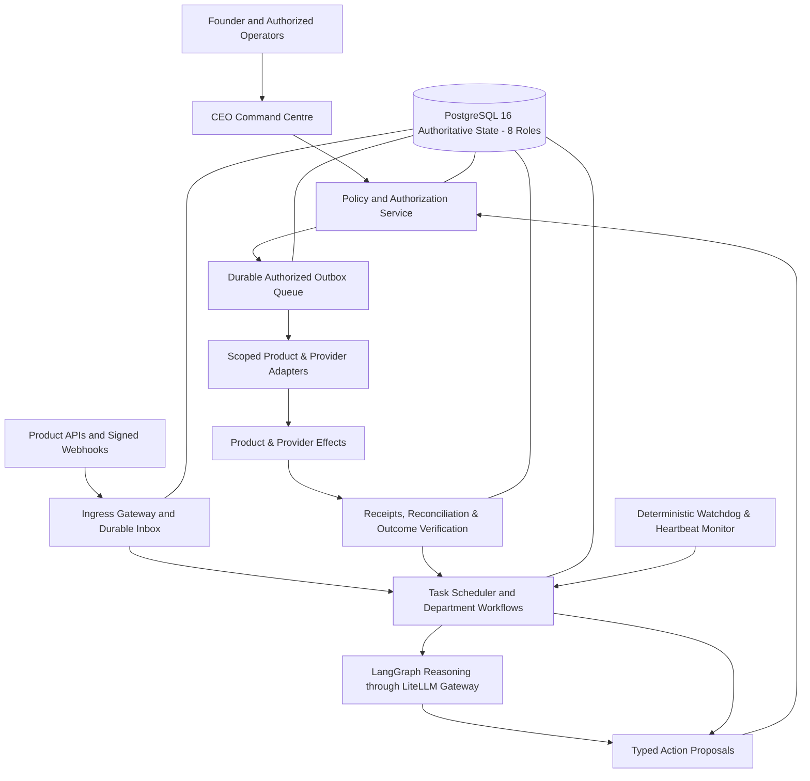

# Multimedia Cloud Solutions — Operating System (MCS-OS v2.2)

Autonomous Corporate Operating System for **Multimedia Cloud Solutions (MCS)**, governing all 11 departments (`D01`–`D11`) and all 7 registered ventures under standing `A0/A1/A2` authority with strictly reserved `A3` principal gates.

---

## 1. System Architecture



---

## 2. Integrated Department Coverage (D01–D11)

- **D01 COO / Executive Operations:** Portfolio observation, task prioritization, 07:30 WAT executive briefing builder.
- **D02 Commercial Lead:** Lead discovery, identity verification, ERPNext CRM integration, quotation generation.
- **D03 CMO / Communications:** Grounded content composition, citation triple verification, social distribution, retraction.
- **D04 Intelligence Lead:** Data feed ingestion, SHA-256 evidence normalization, downstream signal routing.
- **D05 CTO / Engineering & Reliability:** CI pipeline monitoring, isolated test triage, staging deployment runbooks.
- **D06 CFO / Finance Operations:** Usage rollups, deterministic rev-share billing, ERPNext invoices & reconciliation.
- **D07 Customer Operations Lead:** Broadcaster/subscriber ticket intake, tenant isolation, 2m response / 15m resolution SLA tracking.
- **D08 Venture/Product Lead:** Demand radar sensing, venture brief generation, automated staging scaffolding.
- **D09 Compliance/Legal Operations:** Obligation & rights registry, expiry monitoring, data subject export/deletion.
- **D10 People/Vendor Operations:** Vendor subscription monitoring, ERPNext purchase orders, access lifecycle.
- **D11 Independent Assurance:** Continuous audit of controls (CTRL-01 to CTRL-07) and acceptance criteria (L01–L20).

---

## 3. Registered Portfolio Products & Platforms

1. `cloudstream-vcp`: Live HLS/DASH streaming, SSAI telemetry, channel onboarding.
2. `cloudstream-forge`: White-label OTT builder, multi-tenant manifests.
3. `aether-ads`: Sub-3ms ad decision engine, dynamic floor pricing.
4. `aether-adx`: OpenRTB 2.5/3.0 exchange adapter with deployment independence from ADS.
5. `tv-insights`: EPG schedule feeds, star ranking models, media advertiser intelligence.
6. `africasignal`: Macroeconomic assessments, factual claims verification, social distribution.
7. `mcs-app-factory`: Verified information portals (`visatrack-africa`, `skilledpath-africa`) and Demand Radar.
8. `ainatunde/MCS-ERP`: ERPNext v15 + Frappe HRMS (GL, CRM, Support, Procurement) via `ActionEnvelope` + `mcs_external_ref`.

---

## 4. Local Verification & CI Execution

Run the canonical CI qualification gate:

```bash
# Bash (Linux / macOS / Git Bash)
chmod +x scripts/ci.sh
./scripts/ci.sh

# PowerShell (Windows)
.\scripts\ci.ps1
```

All 68 tests across contracts, policy, database, adapters, workflows, Control API, Guardian SRE, and L01–L20 pass.
